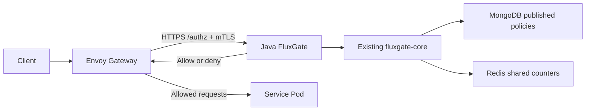

# Envoy Gateway integration and local testing

English | [한국어](../../ko/guides/envoy-local-testing.ko.md)

Connect Envoy Gateway to Java `fluxgate-envoy-extauth`, which uses the existing `fluxgate-core` and MongoDB/Redis adapters. This guide checks allowed requests, authentication rejection and quota enforcement in a kind cluster running on Docker Desktop.

## Request flow



Envoy does not query MongoDB or Redis. FluxGate evaluates a published policy snapshot and shared counters; Envoy then forwards allowed requests to the backend. Backends can use Java, Go, Rust or another language without embedding the FluxGate SDK for gateway enforcement.

With `fluxgate.envoy.published-policies=true`, MongoDB's active published snapshot is authoritative.
Remove `fluxgate.ratelimit.rule-sets` from the authorization service configuration: nonempty YAML
rule sets cause startup rejection in this mode. This prevents local YAML from overriding Studio
publication or ACL changes. The Java SDK and Envoy's non-published mode retain their YAML support.

The default backend is an `echo` Pod. The successful-response check below expects the body `fluxgate-resilience-ok`.

## 1. Select the fixture

Run commands from **this repository's root**. Start Docker Desktop and have `python3` and `kubectl` available. For an existing environment, select the directory containing its `fixture.json`.

```bash
export FLUXGATE_FIXTURE_DIR="${FLUXGATE_FIXTURE_DIR:-/tmp/fluxgate-resilience-private}"
```

For example, if the existing directory is `/tmp/fluxgate-lts-resilience-fixture`, use that value instead. **Use the same value in each terminal.**

If `fixture.json` does not exist, complete [first-time setup](#first-time-setup) before continuing. It contains the kubeconfig, Gateway Service name and credential file paths. Do not print the entire file or key files, or add them to Git. The commands read only the required fields and do not change the default kubectl context.

## 2. Terminal A: forward the Envoy port

```bash
python3 - <<'PYTHON'
import json
import os
import subprocess
from pathlib import Path

fixture = Path(os.environ["FLUXGATE_FIXTURE_DIR"]) / "fixture.json"
f = json.loads(fixture.read_text())
subprocess.run([
    "kubectl", "--kubeconfig", f["kubeconfig"], "--context", f["context"],
    "-n", f["gateway_namespace"], "port-forward", "--address", "127.0.0.1",
    "service/" + f["gateway_service"], "18888:80",
], check=True)
PYTHON
```

Keep this terminal open after `Forwarding from 127.0.0.1:18888` appears. The local request address is `http://127.0.0.1:18888`. Stop forwarding with `Ctrl+C` after testing.

## 3. Terminal B: check allow, authentication and quota

Select the same fixture directory as terminal A. Keys are read from files and never placed in command arguments or output. This test consumes the dedicated quota key's actual allowance.

```bash
export FLUXGATE_FIXTURE_DIR="${FLUXGATE_FIXTURE_DIR:-/tmp/fluxgate-resilience-private}"

python3 - <<'PYTHON'
import http.client
import json
import os
from pathlib import Path

f = json.loads((Path(os.environ["FLUXGATE_FIXTURE_DIR"]) / "fixture.json").read_text())
cases = [
    ("valid key", f["load_path"], "api_key_file", 200),
    ("missing key", f["load_path"], None, 403),
    ("invalid key", f["load_path"], "invalid", 403),
]
cases += [(f"quota {i + 1}", f["quota_path"], "quota_api_key_file", None)
          for i in range(6)]
quota_statuses = []
for label, path, key_field, expected in cases:
    headers = {"Host": f["gateway_host"]}
    if key_field == "invalid":
        headers["x-api-key"] = "local-invalid-key"
    elif key_field:
        headers["x-api-key"] = Path(f[key_field]).read_text().strip()
    conn = http.client.HTTPConnection("127.0.0.1", 18888, timeout=5)
    try:
        conn.request("GET", path, headers=headers)
        response = conn.getresponse()
        body = response.read().decode()
        print(label, response.status)
        if expected is not None:
            assert response.status == expected, label
        else:
            quota_statuses.append(response.status)
        if response.status == 200:
            assert body in (f["backend_body"], f["backend_body"] + "\n"), "backend body"
    finally:
        conn.close()
assert set(quota_statuses) <= {200, 429} and 429 in quota_statuses, "quota boundary"
print("PASS")
PYTHON
```

| Request | Expected result |
|---|---|
| Valid key + `/api/load` | `200` with the exact echo body |
| Missing or invalid key | `403` |
| Quota key + `/api/quota`, six requests | `200` or `429`, with at least one `429` |

The final `PASS` means all three conditions were checked. `/api/quota` allows **five requests per key per day**. A fresh quota identity gets five `200` responses and then `429`. A previously exhausted key can return `429` immediately. Do not change results through retries or Redis counter deletion.

### Repeat from a fresh five-request allowance

In a healthy environment with no load, HA or credential proof running, append a dedicated quota identity.

```bash
python3 deploy/resilience-local/prepare-ha-identity.py \
  --fixture "$FLUXGATE_FIXTURE_DIR/fixture.json" \
  --purpose quota \
  --output "$FLUXGATE_FIXTURE_DIR/manual-quota-preparation-$(date +%Y%m%d-%H%M%S).json"
```

This preserves existing policies and counters while updating the API-key mapping and rolling the authz Pods. After it finishes, rerun the request test. The test rereads the updated `quota_api_key_file`. This does not reset an existing identity's allowance.

## 4. Envoy integration configuration

The actual configuration is in [stack.yaml](../../../deploy/resilience-local/stack.yaml). A `SecurityPolicy` targets an `HTTPRoute` and calls FluxGate's HTTPS `/authz` endpoint.

```yaml
apiVersion: gateway.envoyproxy.io/v1alpha1
kind: SecurityPolicy
metadata:
  name: resilience-ext-auth
  namespace: fluxgate-resilience
spec:
  targetRefs:
    - group: gateway.networking.k8s.io
      kind: HTTPRoute
      name: resilience-api
  extAuth:
    http:
      backendRefs:
        - name: fluxgate-authz
          port: 8443
      path: /authz
    headersToExtAuth: [content-type, x-forwarded-for, x-api-key]
    timeout: 5s
    failOpen: false
    statusOnError: 503
```

mTLS also uses that manifest's `BackendTLSPolicy`, `EnvoyProxy.backendTLS.clientCertificateRef`, and the CA/TLS Secrets generated during setup. `failOpen: false` prevents allowing requests when authorization fails. Error statuses depend on the failure type; do not interpret this setting as a guarantee that every outage returns `503`.

The server validates `x-api-key` against its mapping. Caller-supplied identity or ruleset headers are not authentication results.

## 5. Connect your service Pod

This example assumes these resources already exist in namespace `fluxgate-resilience`:

- Kubernetes Service `my-service`, exposing service port `8080`.
- Backend Pods labeled `app: my-service`, listening on Pod port `8080`.
- An application that handles the `/api/...` paths you will test.

Save the following as a separate `my-service-route.yaml`. It replaces the existing route's backend, so complete the default echo test before applying it.

```yaml
apiVersion: gateway.networking.k8s.io/v1
kind: HTTPRoute
metadata:
  name: resilience-api
  namespace: fluxgate-resilience
spec:
  parentRefs:
    - name: fluxgate-resilience-gateway
  rules:
    - matches:
        - path: {type: PathPrefix, value: /api}
      backendRefs:
        - name: my-service
          port: 8080
---
apiVersion: networking.k8s.io/v1
kind: NetworkPolicy
metadata:
  name: gateway-to-my-service
  namespace: fluxgate-resilience
spec:
  podSelector:
    matchLabels: {app: my-service}
  policyTypes: [Ingress]
  ingress:
    - from:
        - namespaceSelector:
            matchLabels: {kubernetes.io/metadata.name: envoy-gateway-system}
          podSelector:
            matchLabels:
              gateway.envoyproxy.io/owning-gateway-namespace: fluxgate-resilience
              gateway.envoyproxy.io/owning-gateway-name: fluxgate-resilience-gateway
      ports:
        - protocol: TCP
          port: 8080
```

```bash
kubectl --kubeconfig "$FLUXGATE_FIXTURE_DIR/kubeconfig" \
  --context kind-fluxgate-resilience apply -f my-service-route.yaml
```

The existing `SecurityPolicy` still targets the same `resilience-api` route. The additional NetworkPolicy permits traffic from Envoy to the backend's port `8080`. If separate Gateway egress policies exist, allow that destination and port there too. Add any egress permissions the service needs to call databases or external APIs.

The currently published limit policies cover `/api/load` and `/api/quota`. To limit other APIs, validate and publish FluxGate policies matching their paths and methods. Changing routing alone does not create a limit policy. Preserve the authorization service's MongoDB/Redis connections and mTLS configuration.

**After replacing echo with your service, adapt validation to the real paths, policies and responses.** The exact echo-body test above and existing HA/load proofs are not acceptance criteria for a different backend. Restrict direct backend access so ordinary network requests pass through the Gateway.

## 6. Connect a project in another namespace

Projects can share the FluxGate authorization service. Add reference permissions and network rules according to where the service and Route live. The following configurations are alternatives, not steps to apply together.

| Configuration | HTTPRoute namespace | Service namespace | Reference configuration |
|---|---|---|---|
| A: Centrally managed Route | `fluxgate-resilience` | `project-a` | `backendRefs.namespace` and a `ReferenceGrant` in the Service namespace |
| B: Project-managed Route | `project-a` | `project-a` | `parentRefs.namespace` and Gateway `allowedRoutes` |

### A. Connect the existing Route to another project's Service

Assume namespace `project-a` already contains Service `my-service:8080` and Pods labeled `app: my-service`. Keep the Gateway, existing `resilience-api` Route, SecurityPolicy and FluxGate in `fluxgate-resilience`. Actual Envoy Pods run in `envoy-gateway-system` in this installation.

The following replaces the Route example in section 5. The Service namespace owner creates a `ReferenceGrant` allowing that Service reference. This example permits only `my-service`. [Official ReferenceGrant documentation](https://gateway-api.sigs.k8s.io/reference/api-types/referencegrant/)

```yaml
apiVersion: gateway.networking.k8s.io/v1
kind: HTTPRoute
metadata:
  name: resilience-api
  namespace: fluxgate-resilience
spec:
  parentRefs:
    - name: fluxgate-resilience-gateway
  rules:
    - matches:
        - path: {type: PathPrefix, value: /api}
      backendRefs:
        - name: my-service
          namespace: project-a
          port: 8080
---
apiVersion: gateway.networking.k8s.io/v1
kind: ReferenceGrant
metadata:
  name: allow-fluxgate-route
  namespace: project-a
spec:
  from:
    - group: gateway.networking.k8s.io
      kind: HTTPRoute
      namespace: fluxgate-resilience
  to:
    - group: ""
      kind: Service
      name: my-service
```

Also create the section 5 `gateway-to-my-service` NetworkPolicy in `project-a`: **change its `metadata.namespace` to `project-a`** and check the `app: my-service` label and actual Pod listening port. The allowed source is the actual Envoy Pods in `envoy-gateway-system`, with the Gateway ownership labels used in section 5. If separate Gateway egress restrictions exist, allow the destination Pods and port in `project-a` too.

`ReferenceGrant` authorizes resource references; NetworkPolicy governs actual traffic. Configuring only one does not establish connectivity. Since the existing Route name and namespace remain unchanged, preserve its SecurityPolicy and FluxGate mTLS/MongoDB/Redis settings. **The Route remains in the central namespace, so `allowedRoutes: Same` can remain unchanged too.**

### B. Attach a project-managed Route to the shared Gateway

To let a project manage its own HTTPRoute, place its Route and Service in `project-a`. Change only **`spec.listeners[].allowedRoutes`** on the central Gateway's HTTP listener as follows. Preserve existing listener, TLS and infrastructure settings. Include the central namespace to keep the existing Route attached. [Gateway API cross-namespace routing guide](https://gateway-api.sigs.k8s.io/guides/user-guides/multiple-ns/)

```yaml
allowedRoutes:
  namespaces:
    from: Selector
    selector:
      matchExpressions:
        - key: kubernetes.io/metadata.name
          operator: In
          values: [fluxgate-resilience, project-a]
```

Specify the Gateway namespace in the project Route. `project-a.local` is an example local-test Host; use the same request Host header. Production domains must match the actual DNS/TLS configuration.

```yaml
apiVersion: gateway.networking.k8s.io/v1
kind: HTTPRoute
metadata:
  name: project-a-api
  namespace: project-a
spec:
  parentRefs:
    - name: fluxgate-resilience-gateway
      namespace: fluxgate-resilience
  hostnames: [project-a.local]
  rules:
    - matches:
        - path: {type: PathPrefix, value: /api}
      backendRefs:
        - name: my-service
          port: 8080
```

The Route and Service now share a namespace, so **this backend reference does not require a ReferenceGrant.** Route-to-Gateway attachment is controlled by `allowedRoutes`. The NetworkPolicy principles from configuration A also apply to B.

The existing `resilience-ext-auth` targets only the central `resilience-api`; **it does not automatically protect the new `project-a-api`.** One way to apply shared FluxGate authorization is to change the central SecurityPolicy's `spec.targetRefs` to the Gateway while retaining section 4's `extAuth` and mTLS configuration.

```yaml
targetRefs:
  - group: gateway.networking.k8s.io
    kind: Gateway
    name: fluxgate-resilience-gateway
```

Gateway policies apply to attached Routes, but Route-level SecurityPolicies can take precedence. Control project permissions to change shared authorization through RBAC/admission policies and check actual authentication rejection on the new Route. A SecurityPolicy targets resources in its own namespace. If projects instead own separate policies, also design permission to reference the external authz Service. [Official Envoy Gateway SecurityPolicy documentation](https://gateway.envoyproxy.io/v1.9/concepts/gateway_api_extensions/security-policy/)

### Verify configuration and separate project quotas

Use these commands to inspect configuration A. For B, change the first command's namespace and Route name to `project-a` and `project-a-api`.

```bash
kubectl --kubeconfig "$FLUXGATE_FIXTURE_DIR/kubeconfig" \
  --context kind-fluxgate-resilience \
  -n fluxgate-resilience describe httproute resilience-api
kubectl --kubeconfig "$FLUXGATE_FIXTURE_DIR/kubeconfig" \
  --context kind-fluxgate-resilience \
  -n project-a get service,endpointslices,networkpolicies,referencegrants
```

Check Route `Accepted=True` and `ResolvedRefs=True`, and SecurityPolicy `Accepted=True`, for their current generations. Diagnose denied references, missing Service endpoints and NetworkPolicy denial separately. Then validate successful responses, missing/invalid-key `403` and exhausted-quota `429` using requests appropriate for the real service. Adapt the default echo-specific body check to the real response.

Namespace separation does not automatically separate FluxGate quotas. Project-specific limits use published rules and server-verified API-key/tenant identities. Sharing the same rule and key identity can share consumption too. Do not partition limits by trusting an arbitrary caller-supplied project header.

This section contains configuration examples, not evidence of completed cross-namespace deployment or traffic verification. Existing local test results apply to the default echo configuration.

## First-time setup

Run this only if the existing `kind-fluxgate-resilience` environment is absent. It requires Docker Desktop, Java 17+, an environment that can run the Maven wrapper, `kind`, `kubectl`, `helm`, `openssl`, Python 3 and access to download images/charts. This profile runs three kind nodes and multiple HA Pods, so allocate enough Docker CPU and memory.

Set `FLUXGATE_FIXTURE_DIR` as in section 1, then run:

```bash
./mvnw -B -pl fluxgate-envoy-extauth -am package
docker build -f fluxgate-envoy-extauth/Dockerfile \
  -t fluxgate-envoy-extauth:resilience .
python3 deploy/resilience-local/setup.py \
  --fixture "$FLUXGATE_FIXTURE_DIR" \
  --image fluxgate-envoy-extauth:resilience
```

Setup configures Kubernetes 1.35.0, Envoy Gateway 1.9.2, Calico 3.33.0, an authenticated three-member MongoDB replica set and nine Redis members. Authz, echo, Envoy and Gateway controllers each use two replicas. Continue from section 2 after setup finishes.

**Do not repeat setup just to test an existing environment.** `setup.py` scales authz to zero while checking dependencies. Reuse the existing `fixture.json`. Applying the full manifest separately can overwrite the image/configuration selected during setup; use the individual manifest in section 5 when connecting a service.

## Troubleshooting and further verification

| Symptom | Check |
|---|---|
| `context ... does not exist` | Use the private kubeconfig from `fixture.json`, rather than the default kubeconfig |
| Port `18888` already in use | Check existing forwards, or change the port in both terminals |
| `403` | Correct fixture and current API-key file |
| Immediate `429` | Previous consumption by this quota identity; append a dedicated identity for a fresh test |
| `5xx` or timeout | Authz readiness, MongoDB/Redis connectivity, mTLS and NetworkPolicy |
| Gateway `Programmed=False`, `AddressNotAssigned` | Kind can lack an external LoadBalancer address; check listener `Programmed=True`, accepted route/policy conditions and actual responses together |
| Expired authz certificate | Check short-lived local certificates; setup reuses existing certificates and does not renew them just by rerunning |

To automate the healthy in-cluster backend check, use this command. It creates and cleans up a temporary request Pod and dedicated policy, and does not consume the dedicated quota allowance.

```bash
python3 deploy/resilience-local/verify-load.py \
  --fixture "$FLUXGATE_FIXTURE_DIR/fixture.json" \
  --phase control \
  --output "$FLUXGATE_FIXTURE_DIR/manual-control-$(date +%Y%m%d-%H%M%S).json"
```

Follow the [local resilience README](../../../deploy/resilience-local/README.md) for load, HA, network, credential verification and certificate rotation. Run state-mutating proofs one at a time. A simple Service port-forward is pinned to a selected Pod, which matters during longer tests that replace serving Pods.

This is local verification on one Docker Desktop host. It does not prove whole-host resilience or production availability.

- [Envoy Gateway 1.9 External Authorization documentation](https://gateway.envoyproxy.io/v1.9/tasks/security/ext-auth/)
- [Existing FluxGate integration design](../../architecture/envoy-existing-fluxgate-integration.md)
