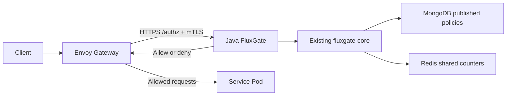

# Envoy Gateway 연동과 로컬 테스트

[English](../../en/guides/envoy-local-testing.md) | 한국어

기존 `fluxgate-core`와 MongoDB·Redis 어댑터를 사용하는 Java `fluxgate-envoy-extauth`를 Envoy Gateway에 연결합니다. 이 가이드는 Docker Desktop 위의 kind 환경에서 정상 요청, 인증 차단, 사용량 제한을 직접 확인하는 방법을 설명합니다.

## 요청 흐름



Envoy는 MongoDB·Redis에 직접 접근하지 않습니다. FluxGate가 게시된 정책 스냅샷과 공유 카운터로 판정하면, Envoy가 허용된 요청을 백엔드로 전달합니다. 백엔드는 Java·Go·Rust 등으로 구현할 수 있으며, 게이트웨이에서 제한하기 위해 FluxGate SDK를 넣을 필요는 없습니다.

`fluxgate.envoy.published-policies=true`에서는 MongoDB의 활성 게시 스냅샷을 기준으로 판정합니다.
판정 서비스의 `fluxgate.ratelimit.rule-sets` 설정을 제거하세요. 비어 있지 않은 YAML 규칙이
함께 있으면 시작을 거절합니다. 로컬 YAML이 Studio의 게시 정책·ACL 변경을 덮는 것을 막기
위한 조건이며, 기존 Java SDK와 Envoy의 비게시 모드는 계속 YAML 규칙을 지원합니다.

기본 테스트 백엔드는 `echo` Pod입니다. 이 가이드의 정상 응답 검증은 `fluxgate-resilience-ok` 본문을 확인합니다.

## 1. 테스트 환경 선택

명령은 **이 저장소의 루트**에서 실행합니다. Docker Desktop을 켜고 `python3`와 `kubectl`을 준비합니다. 기존 환경이 있으면 `fixture.json`이 있는 디렉터리를 지정합니다.

```bash
export FLUXGATE_FIXTURE_DIR="${FLUXGATE_FIXTURE_DIR:-/tmp/fluxgate-resilience-private}"
```

예를 들어 기존 디렉터리가 `/tmp/fluxgate-lts-resilience-fixture`라면 위 변수 값만 그 경로로 바꿉니다. **각 터미널에서 같은 값을 지정**해야 합니다.

`fixture.json`이 아직 없다면 [최초 설치](#최초-설치)를 먼저 진행합니다. 파일에는 kubeconfig, Gateway Service 이름, 자격증명 파일 경로가 들어 있습니다. 내용 전체나 키 파일을 출력하거나 Git에 추가하지 않습니다. 아래 명령은 필요한 필드만 읽으며 기본 kubectl context를 바꾸지 않습니다.

## 2. 터미널 A: Envoy 포트 열기

```bash
python3 - <<'PYTHON'
import json
import os
import subprocess
from pathlib import Path

fixture = Path(os.environ["FLUXGATE_FIXTURE_DIR"]) / "fixture.json"
f = json.loads(fixture.read_text())
subprocess.run([
    "kubectl", "--kubeconfig", f["kubeconfig"], "--context", f["context"],
    "-n", f["gateway_namespace"], "port-forward", "--address", "127.0.0.1",
    "service/" + f["gateway_service"], "18888:80",
], check=True)
PYTHON
```

`Forwarding from 127.0.0.1:18888`이 나타나면 이 터미널을 유지합니다. 로컬 요청 주소는 `http://127.0.0.1:18888`입니다. 테스트가 끝나면 `Ctrl+C`로 종료합니다.

## 3. 터미널 B: 정상·인증·사용량 제한 확인

터미널 A와 같은 fixture 디렉터리를 지정합니다. API 키는 파일에서 읽으며 명령행이나 출력에 포함하지 않습니다. 아래 테스트는 quota 전용 키의 사용량을 실제로 소비합니다.

```bash
export FLUXGATE_FIXTURE_DIR="${FLUXGATE_FIXTURE_DIR:-/tmp/fluxgate-resilience-private}"

python3 - <<'PYTHON'
import http.client
import json
import os
from pathlib import Path

f = json.loads((Path(os.environ["FLUXGATE_FIXTURE_DIR"]) / "fixture.json").read_text())
cases = [
    ("valid key", f["load_path"], "api_key_file", 200),
    ("missing key", f["load_path"], None, 403),
    ("invalid key", f["load_path"], "invalid", 403),
]
cases += [(f"quota {i + 1}", f["quota_path"], "quota_api_key_file", None)
          for i in range(6)]
quota_statuses = []
for label, path, key_field, expected in cases:
    headers = {"Host": f["gateway_host"]}
    if key_field == "invalid":
        headers["x-api-key"] = "local-invalid-key"
    elif key_field:
        headers["x-api-key"] = Path(f[key_field]).read_text().strip()
    conn = http.client.HTTPConnection("127.0.0.1", 18888, timeout=5)
    try:
        conn.request("GET", path, headers=headers)
        response = conn.getresponse()
        body = response.read().decode()
        print(label, response.status)
        if expected is not None:
            assert response.status == expected, label
        else:
            quota_statuses.append(response.status)
        if response.status == 200:
            assert body in (f["backend_body"], f["backend_body"] + "\n"), "backend body"
    finally:
        conn.close()
assert set(quota_statuses) <= {200, 429} and 429 in quota_statuses, "quota boundary"
print("PASS")
PYTHON
```

| 요청 | 예상 결과 |
|---|---|
| 정상 키 + `/api/load` | `200`, 정확한 echo 본문 |
| 키 누락 또는 잘못된 키 | `403` |
| quota 키 + `/api/quota`, 6회 | `200` 또는 `429`, 반드시 한 번 이상 `429` |

마지막 `PASS`는 이 세 조건을 모두 확인했다는 뜻입니다. `/api/quota`는 **키별 하루 5회** 제한입니다. 새 quota identity는 첫 5회가 `200`, 6번째가 `429`입니다. 이전 테스트로 소진한 키는 처음부터 `429`가 나올 수 있습니다. 재시도나 Redis 카운터 삭제로 결과를 바꾸지 않습니다.

### 첫 5회 허용부터 다시 보고 싶다면

다른 부하·HA·자격증명 검증이 실행 중이지 않은 건강한 환경에서, quota 전용 identity를 추가합니다.

```bash
python3 deploy/resilience-local/prepare-ha-identity.py \
  --fixture "$FLUXGATE_FIXTURE_DIR/fixture.json" \
  --purpose quota \
  --output "$FLUXGATE_FIXTURE_DIR/manual-quota-preparation-$(date +%Y%m%d-%H%M%S).json"
```

이 명령은 기존 정책과 카운터를 보존하며 API 키 매핑을 갱신하고 authz Pod를 롤링 재시작합니다. 완료 후 위 요청 테스트를 다시 실행합니다. 테스트 코드는 갱신된 `quota_api_key_file`을 다시 읽습니다. 기존 identity의 한도를 초기화하는 명령이 아닙니다.

## 4. Envoy 연동 설정

실제 설정은 [stack.yaml](../../../deploy/resilience-local/stack.yaml)에 있습니다. `SecurityPolicy`가 `HTTPRoute`에 적용되고 FluxGate의 HTTPS `/authz`를 호출합니다.

```yaml
apiVersion: gateway.envoyproxy.io/v1alpha1
kind: SecurityPolicy
metadata:
  name: resilience-ext-auth
  namespace: fluxgate-resilience
spec:
  targetRefs:
    - group: gateway.networking.k8s.io
      kind: HTTPRoute
      name: resilience-api
  extAuth:
    http:
      backendRefs:
        - name: fluxgate-authz
          port: 8443
      path: /authz
    headersToExtAuth: [content-type, x-forwarded-for, x-api-key]
    timeout: 5s
    failOpen: false
    statusOnError: 503
```

mTLS에는 같은 파일의 `BackendTLSPolicy`와 `EnvoyProxy.backendTLS.clientCertificateRef`, 설치 과정에서 생성하는 CA·TLS Secret도 함께 사용합니다. `failOpen: false`는 판정 서비스 오류 시 요청을 허용하지 않는 설정입니다. 오류 상태는 장애 유형에 따라 달라질 수 있으므로 모든 장애가 반드시 `503`이라고 해석하지 않습니다.

`x-api-key`는 서버의 매핑으로 검증합니다. 클라이언트가 임의로 보낸 identity나 ruleset 헤더를 인증 결과로 사용하지 않습니다.

## 5. 실제 서비스 Pod 연결

예시는 `fluxgate-resilience` 네임스페이스에 다음 리소스가 이미 있다고 가정합니다.

- Kubernetes Service `my-service`: 서비스 포트 `8080`.
- 백엔드 Pod: `app: my-service` 라벨, 실제 수신 포트 `8080`.
- 애플리케이션: 테스트할 `/api/...` 경로를 처리함.

다음 내용을 별도 `my-service-route.yaml`에 저장합니다. 기존 route의 백엔드를 교체하므로, 적용 전 기본 echo 테스트를 먼저 완료합니다.

```yaml
apiVersion: gateway.networking.k8s.io/v1
kind: HTTPRoute
metadata:
  name: resilience-api
  namespace: fluxgate-resilience
spec:
  parentRefs:
    - name: fluxgate-resilience-gateway
  rules:
    - matches:
        - path: {type: PathPrefix, value: /api}
      backendRefs:
        - name: my-service
          port: 8080
---
apiVersion: networking.k8s.io/v1
kind: NetworkPolicy
metadata:
  name: gateway-to-my-service
  namespace: fluxgate-resilience
spec:
  podSelector:
    matchLabels: {app: my-service}
  policyTypes: [Ingress]
  ingress:
    - from:
        - namespaceSelector:
            matchLabels: {kubernetes.io/metadata.name: envoy-gateway-system}
          podSelector:
            matchLabels:
              gateway.envoyproxy.io/owning-gateway-namespace: fluxgate-resilience
              gateway.envoyproxy.io/owning-gateway-name: fluxgate-resilience-gateway
      ports:
        - protocol: TCP
          port: 8080
```

```bash
kubectl --kubeconfig "$FLUXGATE_FIXTURE_DIR/kubeconfig" \
  --context kind-fluxgate-resilience apply -f my-service-route.yaml
```

기존 `SecurityPolicy`는 같은 `resilience-api` route에 계속 적용됩니다. Envoy에서 해당 Pod의 `8080`으로 들어오는 트래픽을 허용하는 NetworkPolicy도 함께 추가합니다. 별도 Gateway egress 정책이 있으면 해당 대상·포트 허용도 필요합니다. 서비스가 DB나 외부 API를 호출한다면 서비스의 필요한 egress도 별도로 설정합니다.

현재 게시된 제한 정책은 `/api/load`와 `/api/quota`용입니다. 다른 API에 제한을 적용하려면 해당 경로·메서드에 맞는 FluxGate 정책을 검증해 게시해야 합니다. 라우팅 설정 변경 자체가 새 제한 정책을 만들지는 않습니다. 기존 판정 서비스의 MongoDB·Redis 연결과 mTLS 설정을 유지합니다.

**실제 서비스로 교체한 후에는 echo 본문을 확인하는 위 테스트와 기존 HA·부하 검증을 그대로 통과 기준으로 사용하지 않습니다.** 실제 서비스 경로·정책·응답에 맞는 별도 검증이 필요합니다. 일반 네트워크 요청이 Gateway를 거치도록 백엔드 직접 접근도 제한합니다.

## 6. 다른 네임스페이스의 프로젝트 연결

FluxGate 판정 서비스는 공유할 수 있습니다. 서비스나 Route가 어느 네임스페이스에 있는지에 따라 참조 권한과 네트워크 설정을 추가합니다. 아래 두 구성은 대안이며 한꺼번에 적용하는 절차가 아닙니다.

| 구성 | HTTPRoute 위치 | 서비스 위치 | 필요한 참조 설정 |
|---|---|---|---|
| A: 중앙에서 Route 관리 | `fluxgate-resilience` | `project-a` | `backendRefs.namespace`와 서비스 네임스페이스의 `ReferenceGrant` |
| B: 프로젝트에서 Route 관리 | `project-a` | `project-a` | `parentRefs.namespace`와 Gateway의 `allowedRoutes` |

### A. 기존 Route에서 다른 프로젝트의 Service 연결

`project-a` 네임스페이스에 Service `my-service:8080`과 `app: my-service` 라벨의 Pod가 이미 있다고 가정합니다. Gateway, 기존 `resilience-api` Route, `SecurityPolicy`, FluxGate는 `fluxgate-resilience`에 유지합니다. 실제 Envoy Pod는 현재 설치의 `envoy-gateway-system`에 있습니다.

다음은 5절 Route 예제의 대체 구성입니다. 서비스 네임스페이스의 관리자가 해당 Service 참조를 허용하는 `ReferenceGrant`를 생성합니다. 이 예제는 `my-service`만 대상으로 허용합니다. [ReferenceGrant 공식 문서](https://gateway-api.sigs.k8s.io/reference/api-types/referencegrant/)

```yaml
apiVersion: gateway.networking.k8s.io/v1
kind: HTTPRoute
metadata:
  name: resilience-api
  namespace: fluxgate-resilience
spec:
  parentRefs:
    - name: fluxgate-resilience-gateway
  rules:
    - matches:
        - path: {type: PathPrefix, value: /api}
      backendRefs:
        - name: my-service
          namespace: project-a
          port: 8080
---
apiVersion: gateway.networking.k8s.io/v1
kind: ReferenceGrant
metadata:
  name: allow-fluxgate-route
  namespace: project-a
spec:
  from:
    - group: gateway.networking.k8s.io
      kind: HTTPRoute
      namespace: fluxgate-resilience
  to:
    - group: ""
      kind: Service
      name: my-service
```

서비스가 존재하는 `project-a`에서 5절의 `gateway-to-my-service` NetworkPolicy도 생성합니다. 해당 정책의 **`metadata.namespace`를 `project-a`로 변경**하고, `app: my-service` 라벨과 실제 Pod 수신 포트가 서비스 구성에 맞는지 확인합니다. 허용 출발지는 실제 Envoy Pod가 있는 `envoy-gateway-system`과 5절의 Gateway 소유 라벨입니다. 별도 Gateway egress 제한이 있다면 `project-a`의 대상 Pod·포트도 허용합니다.

`ReferenceGrant`는 리소스 참조 권한이고 NetworkPolicy는 실제 통신 권한입니다. 둘 중 하나만 설정했다고 연결이 완성되지는 않습니다. 기존 Route 이름·네임스페이스가 유지되므로 기존 SecurityPolicy와 FluxGate mTLS·MongoDB·Redis 연결 설정은 유지합니다. **Route가 중앙 네임스페이스에 남아 있으므로 `allowedRoutes: Same`도 유지할 수 있습니다.**

### B. 프로젝트별 Route를 공통 Gateway에 연결

프로젝트가 자기 `HTTPRoute`를 관리하려면 `project-a`에 Route와 Service를 두고, 중앙 Gateway의 HTTP listener에 있는 **`spec.listeners[].allowedRoutes` 값만** 다음처럼 변경합니다. 기존 listener, TLS, infrastructure 설정은 유지합니다. 중앙 네임스페이스도 포함하여 기존 Route 연결을 보존합니다. [Gateway API 다중 네임스페이스 가이드](https://gateway-api.sigs.k8s.io/guides/user-guides/multiple-ns/)

```yaml
allowedRoutes:
  namespaces:
    from: Selector
    selector:
      matchExpressions:
        - key: kubernetes.io/metadata.name
          operator: In
          values: [fluxgate-resilience, project-a]
```

프로젝트 Route는 다음과 같이 Gateway 네임스페이스를 지정합니다. `project-a.local`은 로컬 테스트용 Host 예시이며, 요청의 Host 헤더도 이 값에 맞춥니다. 운영 도메인은 실제 DNS·TLS 구성에 맞춥니다.

```yaml
apiVersion: gateway.networking.k8s.io/v1
kind: HTTPRoute
metadata:
  name: project-a-api
  namespace: project-a
spec:
  parentRefs:
    - name: fluxgate-resilience-gateway
      namespace: fluxgate-resilience
  hostnames: [project-a.local]
  rules:
    - matches:
        - path: {type: PathPrefix, value: /api}
      backendRefs:
        - name: my-service
          port: 8080
```

이 경우 Route와 Service는 같은 네임스페이스에 있으므로 **이 backend 참조에는 ReferenceGrant가 필요하지 않습니다.** Route → Gateway 연결 권한은 `allowedRoutes`로 제어합니다. A 구성의 NetworkPolicy 원칙은 B에도 적용합니다.

기존 `resilience-ext-auth`는 중앙의 `resilience-api`만 대상으로 하므로 **새 `project-a-api`를 자동으로 보호하지 않습니다.** 공통 FluxGate 판정을 사용하려면 중앙 `SecurityPolicy`의 `spec.targetRefs`를 Gateway 대상으로 변경하고, 4절의 `extAuth`와 mTLS 설정을 유지하는 구성을 사용할 수 있습니다.

```yaml
targetRefs:
  - group: gateway.networking.k8s.io
    kind: Gateway
    name: fluxgate-resilience-gateway
```

Gateway 대상 정책은 연결된 Route에 적용되지만 Route 수준의 SecurityPolicy가 우선할 수 있습니다. 프로젝트가 공통 판정을 변경할 수 있는 권한은 RBAC·admission 정책으로 관리하고, 새 Route의 실제 인증 차단을 확인합니다. SecurityPolicy는 자신과 같은 네임스페이스의 리소스를 대상으로 합니다. 프로젝트별 정책을 별도로 둘 때에는 외부 authz Service 참조 권한도 함께 설계합니다. [Envoy Gateway SecurityPolicy 공식 문서](https://gateway.envoyproxy.io/v1.9/concepts/gateway_api_extensions/security-policy/)

### 적용 후 확인과 프로젝트별 한도

A 구성의 리소스 상태는 다음 명령으로 확인합니다. B 구성에서는 첫 명령의 네임스페이스와 Route 이름을 `project-a`, `project-a-api`로 바꿉니다.

```bash
kubectl --kubeconfig "$FLUXGATE_FIXTURE_DIR/kubeconfig" \
  --context kind-fluxgate-resilience \
  -n fluxgate-resilience describe httproute resilience-api
kubectl --kubeconfig "$FLUXGATE_FIXTURE_DIR/kubeconfig" \
  --context kind-fluxgate-resilience \
  -n project-a get service,endpointslices,networkpolicies,referencegrants
```

현재 세대의 Route `Accepted=True`, `ResolvedRefs=True`와 해당 SecurityPolicy의 `Accepted=True`를 확인합니다. 참조 허용 실패, Service Endpoint 부재, NetworkPolicy 차단은 각각 별도로 진단합니다. 이후 실제 서비스에 맞는 요청으로 정상 응답, 키 누락·오류 `403`, 사용량 초과 `429`를 검증합니다. 기본 echo 전용 본문 검증은 실제 서비스 응답에 맞게 조정합니다.

네임스페이스 분리만으로 FluxGate 한도가 자동으로 분리되지 않습니다. 프로젝트별 한도에는 게시된 규칙과 서버에서 검증한 API 키·tenant 식별자를 사용합니다. 같은 규칙과 같은 키 식별자를 공유하면 사용량도 공유될 수 있습니다. 클라이언트가 보낸 임의의 프로젝트 헤더를 신뢰해 한도를 나누지 않습니다.

이 절은 설정 예제이며 다른 네임스페이스로의 실제 배포·통신 검증 완료를 의미하지 않습니다. 기존 로컬 테스트의 결과는 기본 echo 구성에 대한 증거입니다.

## 최초 설치

기존 `kind-fluxgate-resilience` 환경이 없는 경우에만 실행합니다. Docker Desktop, Java 17+, Maven wrapper 실행 환경, `kind`, `kubectl`, `helm`, `openssl`, Python 3와 이미지·차트 다운로드 연결이 필요합니다. 이 프로파일은 kind 노드 3개와 여러 HA Pod를 실행하므로 Docker에 충분한 CPU·메모리가 필요합니다.

먼저 1절의 `FLUXGATE_FIXTURE_DIR`을 지정한 뒤 실행합니다.

```bash
./mvnw -B -pl fluxgate-envoy-extauth -am package
docker build -f fluxgate-envoy-extauth/Dockerfile \
  -t fluxgate-envoy-extauth:resilience .
python3 deploy/resilience-local/setup.py \
  --fixture "$FLUXGATE_FIXTURE_DIR" \
  --image fluxgate-envoy-extauth:resilience
```

설치는 Kubernetes 1.35.0, Envoy Gateway 1.9.2, Calico 3.33.0, 인증된 MongoDB 3개 멤버와 Redis 9개 멤버를 구성합니다. authz, echo, Envoy, Gateway controller는 각각 2개 복제본을 사용합니다. 완료 후 2절부터 진행합니다.

**기존 환경에 테스트할 때 설치를 반복하지 않습니다.** `setup.py`는 의존성을 확인하는 동안 authz를 0개로 줄입니다. 이미 실행 중인 환경에서는 `fixture.json`을 재사용합니다. 전체 manifest를 별도로 적용하면 설치 시 선택한 이미지·설정을 덮을 수 있으므로, 서비스 연결에는 5절의 개별 manifest를 사용합니다.

## 문제 해결과 추가 검증

| 증상 | 확인할 항목 |
|---|---|
| `context ... does not exist` | 기본 kubeconfig가 아닌 `fixture.json`의 전용 kubeconfig 사용 여부 |
| `18888` 포트 사용 중 | 기존 port-forward 확인 또는 두 터미널의 포트를 함께 변경 |
| `403` | 올바른 fixture와 최신 API 키 파일 사용 여부 |
| 처음부터 `429` | quota identity의 이전 사용량; 새 테스트는 전용 identity 추가 |
| `5xx` 또는 시간 초과 | authz 준비 상태, MongoDB·Redis 연결, mTLS, NetworkPolicy |
| Gateway `Programmed=False`, `AddressNotAssigned` | kind의 외부 LoadBalancer 주소 부재일 수 있음; listener `Programmed=True`, route/policy 수락과 실제 응답을 함께 확인 |
| authz 인증서 만료 | 로컬 인증서의 짧은 유효기간 확인; setup은 기존 인증서를 재사용하므로 재실행만으로 갱신되지 않음 |

클러스터 내부의 정상 경로만 자동 확인하려면 다음을 사용합니다. 임시 요청 생성 Pod와 전용 정책을 만들고 정리하며 quota 전용 한도는 소비하지 않습니다.

```bash
python3 deploy/resilience-local/verify-load.py \
  --fixture "$FLUXGATE_FIXTURE_DIR/fixture.json" \
  --phase control \
  --output "$FLUXGATE_FIXTURE_DIR/manual-control-$(date +%Y%m%d-%H%M%S).json"
```

부하·HA·네트워크·자격증명 검증과 인증서 교체 절차는 [로컬 resilience 검증 README](../../../deploy/resilience-local/README.md)를 따릅니다. 상태를 바꾸는 검증은 한 번에 하나씩 실행합니다. 서비스 Pod를 교체하는 긴 테스트에서는 단순 Service port-forward가 선택한 Pod에 묶인다는 점도 고려해야 합니다.

이 환경은 단일 Docker Desktop 호스트에서의 로컬 검증입니다. 전체 호스트 장애나 운영 환경의 가용성을 증명하지 않습니다.

- [Envoy Gateway 1.9 External Authorization 문서](https://gateway.envoyproxy.io/v1.9/tasks/security/ext-auth/)
- [기존 FluxGate 통합 설계](../../architecture/envoy-existing-fluxgate-integration.md)
